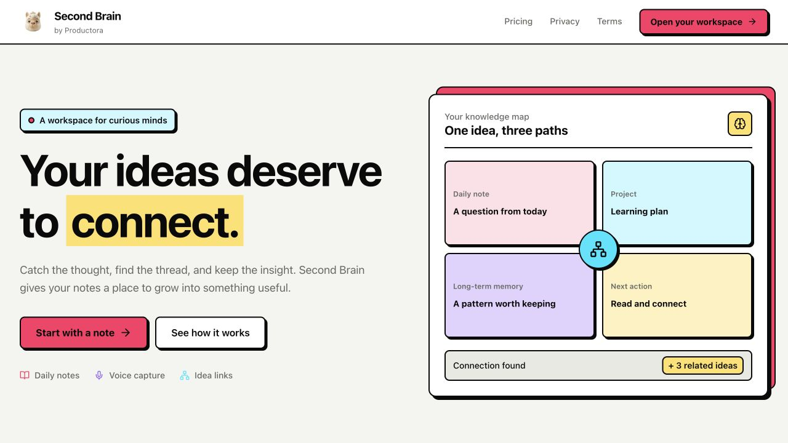

# Second Brain by Productora

Second Brain is a knowledge workspace for capturing thoughts, connecting ideas, and keeping useful insights close.

## Features

- Capture daily notes and voice recordings.
- Keep short-term notes and move lasting ideas into long-term memory.
- Organize notes with projects, tasks, and kanban boards.
- Use AI-assisted tagging, analysis, and connection discovery.
- Explore relationships in the knowledge graph and create Mermaid diagrams.
- Review knowledge and productivity analytics.

## Built with

- React and TypeScript
- Vite
- Tailwind CSS
- Supabase

## Run locally

1. Install dependencies with `bun install`.
2. Copy `.env.example` to `.env.local`.
3. Set `VITE_SUPABASE_URL` and `VITE_SUPABASE_ANON_KEY` in `.env.local`.
4. Start the development server with `bun run dev`.

Open `http://localhost:5173/`. Public landing pages work without Supabase credentials. Authentication and account data require a configured Supabase project.

For the connected Supabase project, `http://localhost:5173/` is an allowed local authentication origin. Registration emails return to the app's current origin. Keep `.env.local` out of Git, and never expose a service-role key through a `VITE_` variable.

## Supabase project notes

The connected project is `juyzcctqoxypkrcdqahg` (Second Brain). The corrective migration `20261017135243_complete_productora_supabase_setup.sql` was applied through the dashboard SQL Editor on 2026-10-17. It updates 24 analytics views to use caller RLS, secures profile creation, and backfills missing profiles. The script can be reapplied, but the dashboard does not record CLI migration history. Reconcile the remote history before running `db push`; the original repository migration is not a complete baseline of the existing database.

The project has four AI edge functions: `ai-tags`, `ai-short-term`, `ai-long-term`, and `ai-mermaid`. AI generation requires a signed-in session and a valid server-side `GEMINI_API_KEY`. It was not invoked during setup.

## License

**Commercial License - All Rights Reserved**

This software and its source code are proprietary and confidential. You may not use, copy, modify, distribute, or create derivative works of this software without explicit written permission from the copyright holder.

Restrictions:

- Commercial use is prohibited.
- Distribution is prohibited.
- Modification is prohibited.
- Private use is prohibited.
- Sublicensing is prohibited.

For licensing inquiries, contact productora.analytics@gmail.com.

Copyright 2025 Second Brain. All rights reserved.

## Acknowledgments

- [Supabase](https://supabase.com) for backend infrastructure.
- [Tailwind CSS](https://tailwindcss.com) for styling.
- [Lucide](https://lucide.dev) for icons.
- [React](https://react.dev) for the frontend framework.

## Support

- Email: productora.analytics@gmail.com
- Issues: [GitHub Issues](https://github.com/violettance/second-brain/issues)
- Business inquiries: productora.analytics@gmail.com
- Security issues: productora.analytics@gmail.com
